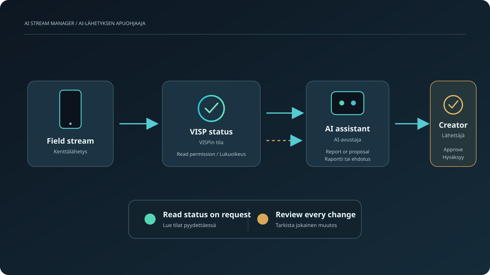

Tekoälyavustaja voi hoitaa muutaman lähetyksen apuohjaajan rutiinin: tarkistaa, lähettääkö puhelin kuvaa, tiivistää vanhentuneen yhteysraportin tai valmistella OBS-näkymän vaihdon hyväksyttäväksi. Se ei näe alustan soitinta eikä kuule ääntäsi, eikä se voi päättää, että lähetys on valmis. Tarkista nämä itse.

VISP Agent Access antaa hyväksytylle AI-asiakasohjelmalle rajatun pääsyn VISPin tilatietoihin. Voit aloittaa pelkillä lukuoikeuksilla ja antaa avustajalle erikseen oikeuden ehdottaa otsikon tai kategorian muutosta, OBS-näkymän vaihtoa tai OBS-lähetyksen aloitusta tai pysäytystä. Hyväksyt jokaisen ehdotuksen itse.

## Mitä tekoäly voi tarkistaa

Aloita lähetyspolkuusi sopivista lukuoikeuksista:

| Oikeus | Mitä avustaja voi tarkistaa |
| --- | --- |
| `streams:read` | Lähettävätkö julkaisulaitteet, niiden lukijamäärät ja viimeisimmät tapahtuma-ajat. |
| `stream-health:read` | Viimeaikaisen bittinopeuden, viiveen, pakettihäviön, yhteyslinkkien määrän ja sen, onko raportti vanhentunut. |
| `direct:read` | VISP Direct -tilan ja lähtöjen tilat tai virheet. |
| `obs:read` | OBS-yhteyden ja lähetyksen tilan, odottavan komennon sekä aktiivisen näkymän. |

Pyydä lyhyt raportti, jossa kerrotaan osa, ilmoitettu tila, havaintoaika ja seuraava itse tarkistettava asia. Voit kysyä esimerkiksi näin:

> Tarkista kenttäpuhelimeni, viimeisin yhteysraportti, Direct-lähdöt ja OBS. Kerro jokaisen tila ja havaintoaika. Ilmoita, jos tieto on vanhentunut. Älä muuta mitään. Kerro, mitä minun pitää tarkistaa Twitchin tai Kickin esikatselusta.

Avustaja voi raportoida vain VISPin tallentamat tiedot. Puhelimen lähettävä tila ei todista, että alustan soittimessa olisi hyvä kuva ja ääni. Yksi tuore yhteysraportti on vain mittaushetken tilanne, eikä se takaa mobiiliverkon pysyvän vakaana reitin aikana.

## Anna vain tarvittavat oikeudet

Avaa VISPin hallintapaneelista **Advanced**, valitse **Connect an agent** ja yhdistä Agent Auth -protokollaa tukeva asiakasohjelma. Tarkista pyydetyt oikeudet ennen niiden hyväksymistä. Yhdistämiskoodi vanhenee, joten luo uusi, jos se ei enää kelpaa.

Aloita lähetyksen tilantarkistuksessa pelkillä lukuoikeuksilla. Et välttämättä tarvitse kaikkia niitä. Jos lähetät VISP Directillä etkä käytä OBSia, jätä `obs:read` pois. Jos OBS tuottaa ohjelman, tarkista OBSin tila ja katso alustan esikatselu itse.

Agentilla on oma tunnisteensa. Se ei saa VISP-salasanaasi, alustatunnuksiasi, lähetysavaimiasi eikä Direct-kohteiden URL-osoitteita. Voit tarkistaa onnistuneet kutsut **Recent activity** -näkymässä ja peruuttaa oikeuden hallintapaneelista.

Lue [VISPin Agent Access -ohjeesta](https://docs.visp-stream.com/fi/docs/agent-access) yhdistämisvaiheet ja kaikkien oikeuksien kuvaukset. Better Authin [Agent Auth -dokumentaatio](https://better-auth.com/docs/plugins/agent-auth) kertoo protokollasta, jolla asiakasohjelmat pyytävät rajattuja oikeuksia.

## Pyydä ehdotuksia, älä anna vapaita ohjia

Jos haluat apua otsikon tai kategorian kanssa, lisää `channel:update`. OBS-näkymän vaihto, lähetyksen aloitus ja pysäytys vaativat omat oikeutensa: `obs:scene:set`, `obs:stream:start` ja `obs:stream:stop`.

Näillä oikeuksilla avustaja voi lähettää pyynnön. Ne eivät käynnistä itsenäistä ohjausta. VISP näyttää tarkan ehdotuksen **Action requests** -näkymässä. Lue se ja hyväksy tai hylkää. Odottava pyyntö vanhenee viidessä minuutissa, ja hyväksyntä koskee vain kyseistä pyyntöä.

Voit pyytää avustajaa valmistelemaan otsikon ennen kuin lähdet uuteen paikkaan. Tarkista pyynnöstä otsikko ja kohdealusta ennen hyväksymistä. Jos ehdotus koskee OBS-näkymää, varmista että valitset oikean näkymän lähetykseen. Pidä aloitus- ja pysäytysoikeudet pois päältä, ellei sinulla ole selvää syytä hyväksyä niitä kesken lähetyksen.

VISP Agent Access ei tällä hetkellä lue tai moderoi live-chattia, tarkastele kuvaa tai ääntä, muuta bittinopeutta eikä seuraa lähetystä jatkuvasti puolestasi. Se lukee VISPin tilatietoja ja voi lähettää ohjeessa lueteltuja ehdotuksia. Käytä live-tilanteissa ihmismoderaattoria, OBS-ohjaimia ja alustan esikatselua.

## Käytä sitä ennen lähetystä ja sen aikana

Pyydä tilanneraportti ennen kuin lähdet kotoa. Tarkista sitten alustan esikatselusta kuva ja kuuntele ääni itse. Jos käytät OBSia, tarkista sen esikatselu ja äänimittarit. Jos käytät Directiä, tarkista juuri se alustalähtö, jonka katsojat näkevät.

Pyydä lähetyksen aikana uusi tilanneraportti tarvittaessa. Kerro, mitä laitetta tai reittiä tarkoitat, ja pyydä havaintoajat. Älä pidä vanhaa vastausta reaaliaikaisena hälytyksenä. Agent Access vastaa yksittäisiin oikeuskutsuihin. Se ei ole jatkuva valvonta- tai ilmoituspalvelu.

Jos raportti löytää ongelman, pyydä avustajaa erottamaan havainnot ehdotuksista. Hyvä vastaus voi kertoa, että puhelin lähettää, sen viimeisin yhteysraportti on vanhentunut ja OBS-yhteys on poikki. Päätä itse, pyydätkö uuden raportin, yhdistätkö studion uudelleen vai tarkistatko Directin. Avustajan ei pidä niputtaa eri tiloja vihreäksi "valmis"-arvioksi.

Anna jokaiselle pyynnölle yksi tehtävä. Pyydä tilannekuva, kun haluat tuoreen tilanneraportin. Jos haluat vaihtaa otsikon, pyydä ehdotus ja tieto siitä, mille alustalle muutos kohdistuu. Jos tarvitset uuden OBS-näkymän, kerro näkymän nimi ja tarkista pyyntö hallintapaneelista. Näin huomaat helpommin, jos avustaja ymmärsi lähetyspolun väärin tai ehdottaa näkymää, jota ei pidä näyttää katsojille.

Voit pyytää avustajaa laatimaan myös lyhyen tilanneviestin moderaattorille tai kotistudion tuottajalle. Pyydä sitä listaamaan VISPin ilmoittamat tiedot, vielä varmistamattomat asiat ja seuraava itse tehtävä tarkistus. Jätä yksityiset tiedot pois viestistä. Lukuoikeudet eivät palauta lähetysavaimia tai Direct-kohteiden URL-osoitteita, mutta toiseen keskusteluun kopioimasi teksti voi silti sisältää kanavan tietoja tai sijainnin, jota et halua jakaa.

Pidä toimintopyyntöä huomionherättäjänä, älä jo painettuna painikkeena. OBS-lähetyksen pysäytys voi keskeyttää ohjelman, ja näkymän vaihto voi paljastaa väärää sisältöä. Jos et ehdi tarkistaa pyyntöä, anna sen vanhentua ja käytä suoraan näkyvissä olevaa ohjaustapaa. Viiden minuutin vanhenemisaika on hyödyllinen turvaraja, mutta se ei korvaa ymmärrystä siitä, mitä ehdotettu toiminto tekee.

Seuraa [IRL-lähetyksen testauslistaa](/fi/blog/test-irl-stream-before-going-live), kun harjoittelet toistettavaa ennakkotarkistusta. Jos sinun täytyy käyttää OBSia etänä, lue [ohje OBSin hallintaan puhelimella ilman porttiohjausta](/fi/blog/control-obs-phone-without-port-forwarding). Nämä ohjaimet ovat eri asia kuin AI-agentin hyväksyntää odottavat toimintopyynnöt.

## Pidä ihminen päätöksentekijänä

Tekoäly sopii lähetyksen apuohjaajaksi parhaiten tilatietojen lukemiseen ja yksittäisten muutospyyntöjen valmisteluun. Se kokoaa VISPin tiedot yhteen raporttiin ja näyttää ehdotetun muutoksen tarkistettavaksi. Sinä vastaat kuvasta, äänestä, yksityisyydestä, alustan esikatselusta ja päätöksestä aloittaa lähetys.

Kokeile työnkulkua [ottamalla VISP käyttöön](https://docs.visp-stream.com/fi/docs/get-started), yhdistämällä Agent Auth -yhteensopiva asiakasohjelma ja aloittamalla lukuoikeuksista. Lisää toimintaoikeuksia vasta, kun olet valmis tarkistamaan jokaisen pyynnön hallintapaneelissa.

### Lähteet ja lisätietoa

- [VISPin Agent Access -dokumentaatio](https://docs.visp-stream.com/fi/docs/agent-access)
- [Better Authin Agent Auth -dokumentaatio](https://better-auth.com/docs/plugins/agent-auth)
- [VISPin IRL-lähetyksen testauslista](/fi/blog/test-irl-stream-before-going-live)
- [VISPin OBS-etäohjauksen dokumentaatio](https://docs.visp-stream.com/fi/docs/obs-remote-control)
