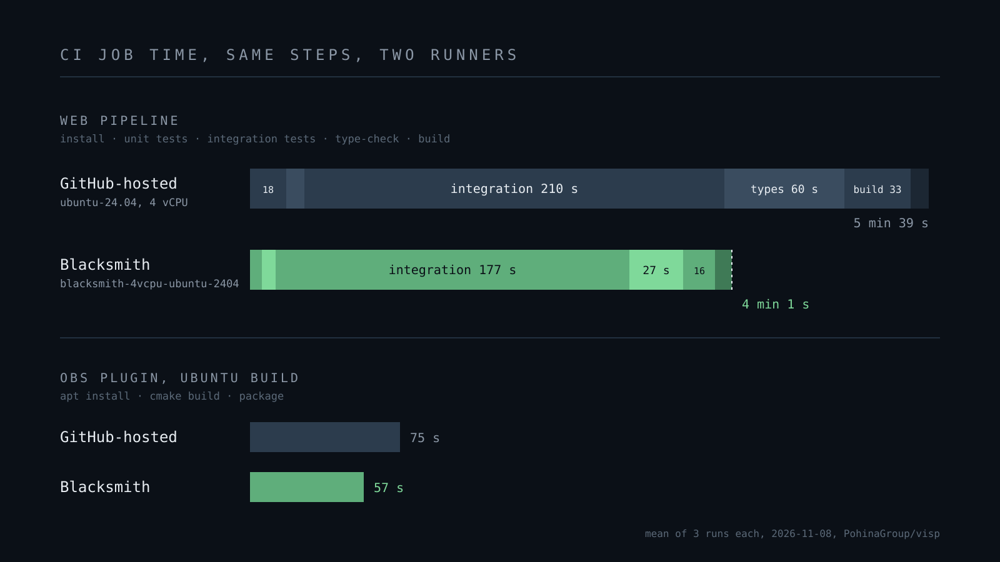

VISP's GitHub Actions workflows moved from GitHub-hosted runners to
[Blacksmith](https://www.blacksmith.sh) in July 2026. The change was one line
per job, `runs-on: ubuntu-24.04` became `runs-on: blacksmith-4vcpu-ubuntu-2404`,
and nobody measured anything at the time. It felt faster. Feelings are not a
benchmark, so this week we ran the same jobs on both runner types, side by
side, and pulled four months of job history to see what the switch actually
bought us.

Short version. Blacksmith is faster on every CPU-bound step we have, usually by
about 2x. Our jobs as a whole finished 24 to 30 percent sooner, because the
longest step in our pipeline is mostly waiting, and waiting is the same speed
everywhere. Blacksmith's queue times are worse than GitHub's, sometimes by
minutes. And for a public repository like ours, GitHub-hosted runners are
free, so this is a trade of money for time. We think the trade is worth it. We
also think the vendor's "67% savings" headline does not describe us.

## What we measured

Two jobs, copied step for step from our real workflows, each run three times on
each runner type in one workflow run on 8 November 2026.

The first job is the check-and-build pipeline that runs on every push to
staging. It checks out the repo, installs dependencies with Bun, runs the unit
tests, runs the integration tests against a PostgreSQL container, type-checks
fifteen packages with TypeScript, then builds the API server, the portal, the
admin app, the multi-chat page and the Typography app with Turborepo and Vite.
This is the job that gates every deploy, so its wall time is the number we
care about.

The second job builds the [VISP OBS plugin](/blog/control-obs-phone-without-port-forwarding)
for Ubuntu. It is a C++ build through CMake with the OBS plugin template's
scripts, then a Debian package. This one still runs on GitHub-hosted runners in
production, because the plugin's Windows and macOS builds need GitHub's images
anyway and the Ubuntu leg was never moved. That gave us a nice side effect. We
have 158 historical runs of this exact job on GitHub to check our sample
against.

The GitHub side is the standard `ubuntu-24.04` label. On a public repository
that is a 4 vCPU, 16 GB machine. The Blacksmith side is the
`blacksmith-4vcpu-ubuntu-2404` label, also 4 vCPU. Same step list, same action
versions, same lockfile. No Blacksmith-specific caching actions, no sticky
disks, nothing that would not work on the GitHub side. We wanted to know what
the hardware does on its own.

## The results

| Step, web pipeline | GitHub-hosted | Blacksmith | Faster by |
| --- | --- | --- | --- |
| Install dependencies (Bun) | 18 s | 6 s | 3x |
| Unit tests | 9 s | 7 s | 1.3x |
| Integration tests | 210 s | 177 s | 1.2x |
| Type-check (tsc, 15 packages) | 60 s | 27 s | 2.2x |
| Build (Turborepo + Vite) | 33 s | 16 s | 2.1x |
| **Whole job** | **339 s** | **241 s** | **1.4x** |

| OBS plugin, Ubuntu | GitHub-hosted | Blacksmith | Faster by |
| --- | --- | --- | --- |
| apt install (zsh, ccache) | 10 s | 6 s | 1.7x |
| CMake build | 52 s | 42 s | 1.2x |
| **Whole job** | **75 s** | **57 s** | **1.3x** |

The three Blacksmith runs of the web job landed within six seconds of each
other. The GitHub runs spanned 325 to 346 seconds. The OBS build varied more on GitHub,
66 to 90 seconds, and that matches its history. Over 158 production runs on
GitHub the median was 82 seconds and the 90th percentile 157 seconds, so our
sample of 75 is, if anything, a good day for GitHub.

The steps that are pure compute show what the vendor promises. Type-checking
fifteen TypeScript packages went from 60 seconds to 27. The Vite and Turborepo
build went from 33 to 16. Dependency install went from 18 seconds to 6, which
is as much about disk and network as CPU. Blacksmith says its machines have
the highest single-core performance of any runner, and `tsc` is about as
single-core as workloads get, so this is the best case for them.

The C++ build is a weaker win. CMake with four parallel jobs is already using
all four cores on both machines, so the gap is the per-core speed difference
and not much else. 52 seconds to 42.

## Why the whole job only got 30 percent faster

Look at the integration test row. 210 seconds on GitHub, 177 on Blacksmith.
It is by far the longest step and it barely moved.

We pulled the step logs from both runners and looked for gaps between
timestamps. The three biggest gaps were the same on both machines, to within
a second. About 49 seconds in the relay snapshot test, which waits for a
deliberate encoder kill. About 40 seconds in the proxy route test, which starts
a Caddy container and probes it. About 25 seconds in the release script test,
which waits for simulated upstreams before a reload. That is roughly 115
seconds of sleeping, timeouts and health-check polling that run at exactly one
second per second on any hardware.

So of the 339 second GitHub job, about a third is wall-clock waiting that no
runner can shorten. The compute part went from roughly 225 seconds to roughly
125, which is close to the 2x the vendor claims. The job as a whole went from
5 minutes 39 seconds to 4 minutes 1 second.

This is the honest shape of "2x faster hardware" for most teams. Your pipeline
is faster by 2x on the parts that were CPU-bound, and not at all on the parts
that were waiting for a container to become healthy. If you want the whole job
to be 2x faster, you have to go fix the waiting, and a new runner will not do
that for you. Our next CI improvement is clearly in those shell tests, not in
the `runs-on` line.

## Queue times, where GitHub wins

A job's wall time is not the only thing you wait for. Before a job starts, it
sits in a queue until a runner picks it up. We pulled this number for every
successful job in the repository since the switch, 332 Blacksmith jobs and
241 GitHub-hosted Ubuntu jobs between 19 July and 27 October.

| Time from queued to running | GitHub `ubuntu-24.04` | Blacksmith 4 vCPU |
| --- | --- | --- |
| Median | 3 s | 14 s |
| 90th percentile | 5 s | 143 s |
| 99th percentile | 11 s | 1453 s |
| Longest | 15 s | 3176 s |
| Jobs that waited over a minute | 0 of 241 | 62 of 332 |

GitHub's queue is boring in the best way. The slowest of 241 jobs waited 15
seconds. Blacksmith's median of 14 seconds is fine, but one job in five waited
over a minute, one in ten waited over two minutes, and the worst case was
53 minutes. We have no idea why those tails happen and the dashboard does not
say. It may be capacity in their pool at busy times, it may be something about
how our jobs arrive in bursts when a release fans out into six parallel jobs.

In our benchmark run both queues were quiet, 3 seconds on GitHub and 7 on
Blacksmith, so the numbers above are what the tail looks like, not what a
typical afternoon looks like. But a deploy pipeline that saves 98 seconds of
compute and then waits 143 seconds for a runner has not saved anything, and
that happens to us about once in ten jobs. We would trade a little of the raw
speed for a flatter queue.

## What it costs

Our repository is public. GitHub-hosted standard runners are free and
unlimited on public repositories, so before July our CI cost nothing.
Blacksmith's 4 vCPU Ubuntu runner is $0.008 per minute, with 3,000 free
minutes a month.

We added up every Blacksmith job minute by month from the job history,
excluding two cancelled mobile builds whose timestamps claim they ran for
eleven days. Our busiest month, September, used about 1,170 minutes. The
others were between 100 and 270. We have never left the free tier. If we did,
September would have been about nine dollars.

The vendor's pricing page says "67% savings", from 2x faster runtime and a
per-minute price 33 percent below GitHub's. For a private repository paying
GitHub per minute that arithmetic can hold. For us it is nonsense in both
directions. Our minutes were free before, so the saving is negative, and the
jobs are 1.3x to 1.4x faster, not 2x. What we actually bought is about 98
seconds off every staging deploy and about 18 seconds off every OBS plugin
build, for zero dollars as long as we stay under 3,000 minutes.

## One thing that broke

One of the three GitHub-hosted web runs failed in the integration tests, and
it was our fault, not GitHub's. The proxy route test starts Caddy with
`docker run --rm --name visp-proxy-<pid>`, stops it, then starts it again with
the same name for the next case. With `--rm`, Docker removes the container
asynchronously after it exits. On a machine that is a little slower to reap
containers, the second `run` lands before the first container is gone, and
Docker refuses the duplicate name. It passed on the rerun.

We mention it because the faster runner hides this race. It never showed up
on Blacksmith in four months, and it showed up on GitHub on the first try. A
faster machine is not a fix for a race condition, it just makes you forget you
have one. The fix was one line on our side, a counter in the container name,
and it ships with this post.

## What we are doing with this

We are staying on Blacksmith for the jobs that are already there. A minute and
a half off every deploy is real, and for our volume it is free. The
one-line switch cost nothing to make and would cost nothing to undo, which is
the best kind of vendor relationship to be in.

The OBS plugin's Ubuntu build is worth moving over too. It is 18 seconds a run
and it was only left behind by accident.

We are not going to pretend the numbers are bigger than they are. The 2x claim
is true of the hardware and false of our pipeline, and the queue tail is a
real cost that the marketing does not mention. If your jobs are mostly `tsc`,
Vite and compilers, expect close to 2x. If your jobs are mostly waiting for
containers and health checks, expect 1.2x and go fix the waiting first.

And we are going to shorten those three shell tests. 115 seconds of sleeping
on every push is the biggest CI improvement left on the table, and it is on our
side of the `runs-on` line.

## How to reproduce this

The benchmark workflow is in the repository on the `bench/blacksmith-vs-github`
branch as `.github/workflows/benchmark.yml`. It is a matrix over the two runner
labels and three iterations, with the step list copied from the staging and
OBS plugin workflows. Step timings come from the GitHub Actions jobs API, which
reports started and completed timestamps for every step. Queue times are the
difference between a job's `created_at` and `started_at` in the same API, over
every completed run the repository still has. The analysis was a short Python
script over that JSON, nothing clever.

If you run the same comparison on your own pipeline, do the step-level
breakdown before you look at the total. The total tells you whether to switch.
The breakdown tells you what to fix next, and in our case that was the more
useful number.
