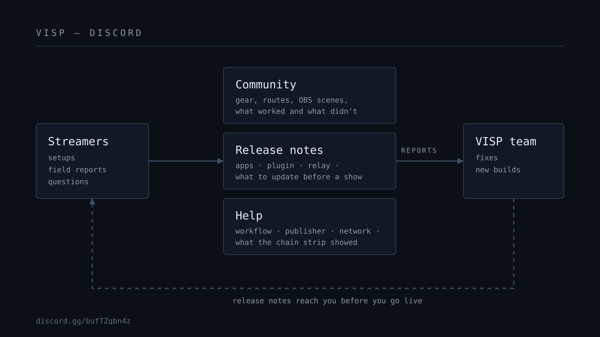

VISP now has a Discord server. You can join at
[discord.gg/bufTZqbn4z](https://discord.gg/bufTZqbn4z).

We opened it for three reasons. IRL streamers learn most from other IRL
streamers. Release notes should reach people the day a build ships, not
whenever someone checks a changelog. And setup questions are easier to answer
in a conversation than in a contact form.

This post explains what happens on the server, what you get from joining, and
how to ask for help so the answer comes back fast.

## Why a Discord server and not just docs

The [VISP docs](https://docs.visp-stream.com) cover how each part works: the
phone app, the browser publisher, VISP Direct, the OBS plugin, the chat bot,
and self-hosting. Docs are good at answering "how does this feature work."

They are bad at answering "will this work on my bike ride through a city with
weak 4G" or "which phone mount stops my iPhone from overheating in July."
Those answers come from people who have done it. A real stream has a lot of
variables that no page can list: the carrier, the phone model, the case, the
weather, the venue Wi-Fi, the destination platform, and what else the phone
is doing at the same time.

Discord also gives us a direct line back. When three people report the same
odd reconnect on the same Android version in one afternoon, we can see the
pattern and fix it. A bug that only shows up in a stadium, a train, or a
mountain valley is hard to reproduce at a desk. Your field reports are how we
find those.

## Community: compare setups with people who stream outside

Most of the server is people talking to each other. Expect conversations like
these:

- what phone, mount, power bank, and microphone someone carries for a walking
  stream;
- whether bonding Wi-Fi and cellular helped on a given route, or whether
  packet duplication worked better;
- how someone set up their OBS scenes around a phone feed, including the
  holding scene they show when the field camera drops;
- when VISP Direct was enough and when they still wanted OBS in the path;
- clips from streams that went well, and honest notes on the ones that did
  not.

Post your setup, even if it is simple. A phone, a clip-on mic, and Direct to
one platform is a valid setup, and it is the one most new streamers start
with. Someone reading the server next month will find your post when they ask
the same question.

Share what failed, too. "The stream died at 40 minutes because the phone hit
thermal limits in direct sun" is more useful to the next person than a perfect
run. It also tells us where VISP needs to warn earlier or degrade more
gracefully.

## Release notes: know what changed before you go live

VISP has several parts that ship on their own schedules:

- the iOS and Android phone apps, through the App Store and Google Play;
- the browser publisher and the web dashboard;
- the OBS plugin, through the
  [GitHub releases page](https://github.com/PohinaGroup/visp/releases);
- the OBS Remote app for scene and stream control;
- the relay, which handles ingest, VISP Direct forwarding, and the BRB card.

A change in any of these can affect your stream. A new app build might change
how network bonding behaves. A relay update might change how Direct retries a
destination. A plugin release might add a control you have been asking for.

We post release notes on the Discord when a build goes out. Each note says
what changed, which part it affects, and whether you need to do anything, such
as update the OBS plugin or re-authorize a platform.

This matters most before an event. The safest habit for a planned stream is:
read the latest notes, update the parts you use, and run one private
rehearsal on the new versions. Do not find out about a changed default in the
first minute of a live show.

Release notes are also the place to report a regression. If something worked
on the previous build and broke on this one, reply to that release note with
your device and what changed. That puts the report next to the change that
probably caused it.

## Help: get unstuck faster

You can ask anything about VISP on the server. Common topics:

- the setup wizard, sign-in with Twitch, Kick, or Google, and creating
  publishing devices;
- getting the phone app or browser publisher connected;
- adding the VISP feed to OBS and pairing the OBS plugin;
- authorizing Twitch, Kick, or YouTube for VISP Direct;
- the BRB screen and the chat bot alerts;
- network bonding and what to expect on mobile data;
- self-hosting your own relay and app host.

Other streamers often answer before we do. That is fine, and usually faster.
We read the help threads and step in where an answer needs to come from the
team, such as account problems, relay capacity, or a suspected bug.

### How to ask so you get a useful answer

A good help post answers the questions we would ask first. Include:

1. **Your workflow.** VISP Direct to a platform, or the phone feed into your
   own OBS.
2. **Your publisher.** The VISP iPhone or Android app, the browser publisher,
   or another SRT, SRTLA, or RTMP encoder. Add the app version and the phone
   model.
3. **Your destination.** Twitch, Kick, YouTube, or a custom RTMP, RTMPS, or
   SRT endpoint.
4. **Your network.** Wi-Fi, cellular, or both with bonding. Say roughly where
   you were and how strong the signal was.
5. **What the dashboard showed.** The signal chain strip at the top of the
   dashboard shows sources, relay, OBS, and output. Note which part looked
   wrong.
6. **What you expected and what happened instead,** with the time it
   happened. A timestamp helps us find the matching relay events.

A screenshot of the dashboard or the app's error message is often worth more
than a paragraph.

### Never post secrets

Do not paste a publish URL, a read credential, or a platform stream key into
Discord, not even in a screenshot. A publish URL lets anyone send video as
your device.

If you share one by accident, revoke that device on the dashboard and create
a new one. Each publishing device can be revoked on its own, so the rest of
your setup keeps working. If a platform stream key leaks, reset it at the
platform.

We will never ask you for a password, a stream key, or a publish URL in a DM.
If someone does, it is not us. Report it to the moderators.

### When to use GitHub instead

VISP is open source under GPL-2.0. If you have found a reproducible bug in the
code, or you self-host and want to discuss a change to the relay or app host,
an issue on [GitHub](https://github.com/PohinaGroup/visp) is the better home.
It keeps the history next to the code. Discord is the place for "is this a
bug or am I doing something wrong," and for anything that needs a quick back
and forth.

## Feature requests and feedback

Tell us what you want VISP to do. Features like Direct to several platforms
at once, chat alerts that work with your computer off, and the BRB screen
that keeps the broadcast up while the phone reconnects all started as
streamer problems.

The most useful requests describe the problem, not only the solution. "I lose
viewers when my stream drops on the subway because they think I ended" tells
us more than "add a button." Several people describing the same problem in
their own words is how a request moves up the list.

If you are part of the
[Founding Creator Program](/affiliate), the Discord is also the easiest place
to reach us about it.

## House rules

The rules are short:

- be decent to each other, including to people who are new to streaming;
- keep help questions where the next person can find them, not scattered in
  DMs;
- no stream keys, publish URLs, or other secrets;
- keep self-promotion out of help threads.

Moderators may remove posts that break these rules, and they will remove
anything that exposes someone's credentials.

## Join

The invite link is
[discord.gg/bufTZqbn4z](https://discord.gg/bufTZqbn4z). You can also find it
in the header and footer of [visp-stream.com](https://visp-stream.com) and in
the [docs](https://docs.visp-stream.com) navigation.

When you join, say hi and tell us what you stream and where. If you have not
tried VISP yet, [get the apps](/download), set up one test device, and bring
your first question to the server. Someone there has probably streamed
from somewhere stranger.
