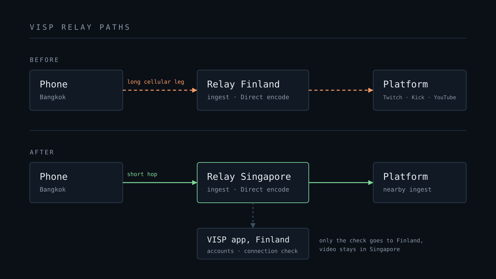

VISP ajaa nyt toista relayta, Singaporessa. Tähän asti jokainen VISP-striimi
kulki yhden Suomessa sijaitsevan relayn kautta. Puhelin Bangkokissa,
Manilassa tai Sydneyssä lähetti videonsa kahden mantereen yli ennen kuin VISP
pystyi tekemään sille mitään.

Singaporen relay tekee koko työn paikallisesti. Se ottaa vastaan SRT:n,
yhdistetyn SRTLA:n, RTMP:n ja selainlähetyksen. Se ajaa
[VISP Directin](/fi/blog/what-is-visp-direct) enkoodauksen, palvelee OBS-luvut
ja hallintapaneelin esikatselut ja ajaa Cloud Studion. Singaporeen määritetyn
laitteen video pysyy Singaporessa, kunnes se lähtee palveluun tai OBS:ääsi.

Tässä kirjoituksessa kerromme, kenelle relay on tarkoitettu, mikä striimissä
muuttuu, mikä pysyy ennallaan ja miten jo olemassa oleva laite siirretään.

## Kenelle se on

Jos striimaat Kaakkois-Aasiasta tai Australiasta, Singapore on sinua paljon
lähempänä kuin Suomi. Myös Japani, Korea ja Taiwan ovat lähempänä Singaporea
kuin Suomea, tosin vähemmällä erolla. Arvata ei tarvitse. Sovellus mittaa
jokaisen relayn puhelimesi verkosta ja valitsee nopeimman.

Jos striimaat Euroopasta, mikään ei muutu. Suomi pysyy oletusrelayna, ja VISP-
sovellus, hallintapaneeli ja tilit toimivat edelleen siellä.

## Mikä striimissä muuttuu

### SRT:llä on enemmän aikaa korjata kuva

SRT korjaa kadonneet paketit pyytämällä puhelinta lähettämään ne uudelleen.
Jokainen uudelleenlähetys vie vähintään yhden edestakaisen matkan puhelimen ja
relayn välillä, ja SRT-latenssiasetus on aikabudjetti kaikille niille.
Aasiasta Suomeen kulkevalla reitillä yksi edestakainen matka vie suuren osan
budjetista. Paketti, jota ei ehditä lähettää uudelleen, muuttuu suttuiseksi tai
jäätyneeksi kuvaksi.

Kun relay on lyhyen matkan päässä, sama latenssiasetus riittää useampaan
uudelleenlähetykseen. Pätkivällä mobiiliyhteydellä se tarkoittaa vähemmän
rikkinäisiä kuvia. [Huonon mobiiliverkon opas](/fi/blog/keep-stream-live-bad-mobile-network)
kertoo muusta palautumisketjusta, eikä siitä muutu mikään.

Yhdistetyt SRTLA-yhteydet päättyvät myös Singaporen relayhin. Wi-Fi ja
mobiiliyhteys yhdistävät molemmat Singaporeen, ja relay kokoaa paketit siellä.

### Direct lähtee Singaporesta

Directissä relay enkoodaa syötteesi uudelleen ja lähettää sen Twitchiin,
Kickiin, YouTubeen tai omaan RTMP-, RTMPS- tai SRT-osoitteeseen. Singaporen
relayn laitteella enkoodaus tapahtuu Singaporessa ja yhteys palveluun alkaa
sieltä. Twitchin vastaanotto-osoite valitsee vastaanottopisteen sijainnin
mukaan, joten relay yltää nyt lähellä olevaan Twitchin vastaanottopisteeseen
eurooppalaisen sijaan. Katsojille näkyvä striimi ei enää ylitä kahta mannerta
ennen kuin se edes saapuu palveluun.

Puhelimessa ei edelleenkään ole striimiavaintasi. Se ei muutu.

### OBS kotona, puhelin reissussa

Oletetaan, että asut Euroopassa, ajat OBS:ää kotona ja vietät kaksi viikkoa
Thaimaassa. Ennen tätä relayta pitkä osuus kulki puhelimesta Suomeen hotellin
Wi-Fin tai paikallisen SIM-kortin kautta. Kun puhelin on Singaporessa, sen
osuus on lyhyt. Pitkä osuus kulkee nyt Singaporesta kotisi OBS:ään kotisi
yhteyttä pitkin.

Se on parempi paikka etäisyydelle. Kiinteässä kotiyhteydessä katoaa vähemmän
paketteja ja ajoitus on tasaisempi kuin mobiiliverkossa olevassa puhelimessa.
Anna OBS:n SRT-medialähteelle tarpeeksi latenssia Aasian ja Euroopan väliselle
edestakaiselle matkalle, ja siirrä laite takaisin Suomeen, kun olet kotona.

## Mikä pysyy ennallaan

- Tilit, hallintapaneeli, chat-botti ja palveluiden valtuutukset toimivat
  Suomessa. Hallintapaneelin ja sovelluksen pyynnöt Aasiasta kestävät hieman
  aiempaa kauemmin.
- Singaporen relay tarkistaa jokaisen uuden lähetys- tai lukuyhteyden
  Suomessa olevalta VISP-sovellukselta ennen kuin hyväksyy sen. Se lisää
  yhdistämiseen noin neljännessekunnin. Kun striimi on yhdistetty, sen video
  ei palaa Suomeen. Viiveen huomaa lähinnä, kun puhelin yhdistää monta kertaa
  peräkkäin, esimerkiksi kun yksi yhdistetty yhteys katkeilee.
- Laitteen tunniste, lähtöasetukset ja historia säilyvät siirrossa.
- VISP ei koskaan siirrä olemassa olevaa laitetta itse. Laitteesi pysyvät
  Suomessa, kunnes siirrät ne.

## Uudet laitteet valitsevat lähimmän relayn

Kun lisäät laitteen puhelinsovelluksessa, selainjulkaisijassa tai
hallintapaneelissa, VISP mittaa edestakaisen ajan jokaiseen relayhin ja luo
laitteen nopeimpaan. Kun puhelinsovellus yhdistää uuden tilin, se siirtää myös
tilin ensimmäisen, vielä käyttämättömän striimipolun mitattuun relayhin. Jos
mittaus epäonnistuu, laite menee Suomeen.

Yksi poikkeus pitää Directin luovutuksen toiminnassa. Kun Direct-istunto,
BRB-ruutu tai varaus on käynnissä, uudet laitteet liittyvät saman istunnon
relayhin, jotta laitteesi voivat luovuttaa lähdön toisilleen.

## Siirrä olemassa oleva laite Singaporeen

1. Pysäytä kaikki, mikä käyttää laitetta: puhelin tai enkooderi, OBS-lähteet,
   hallintapaneelin esikatselut sekä Direct- ja BRB-lähdöt. Odota minuutti
   viimeisen yhteyden sulkeutumisesta. Siirtoa ei voi tehdä, kun laite on
   livenä.
2. Avaa puhelimessa, jolla striimaat, **Settings > Advanced > Relay region**
   ja napauta **Find best relay**. Sovellus mittaa puhelimen omasta verkosta
   ja kysyy ennen kuin siirtää mitään. Voit myös avata laitteen
   hallintapaneelissa ja valita **Move to Singapore**.
3. Laitteen lähetys- ja vastaanotto-osoitteet vaihtuvat, ja vanhat lakkaavat
   toimimasta. **Find best relay** päivittää VISP-sovelluksen oman osoitteen.
   Hallintapaneelin kautta tehdyn siirron jälkeen päivitä kohde sovelluksessa.
   Päivitä osoite OBS:ään ja ulkoisiin enkoodereihin, kuten Larixiin tai
   Mobliniin.
4. Jos luovutat Directin useamman laitteen välillä, siirrä ne kaikki samaan
   relayhin ennen kuin menet liveen.

[Tee sitten yksityinen testistriimi](/fi/blog/test-irl-stream-before-going-live)
ennen oikeaa lähetystä. Palataksesi pysäytä laite ja valitse hallintapaneelissa
**Move to Finland**.

## Älä koske SRT-latenssiin heti

Lyhyempi reitti houkuttelee laskemaan SRT-latenssia saman tien. Odota. Aja
uudella relaylla muutama striimi asetuksella, johon jo luotat, ja seuraa
uudelleenyhdistämisiä ja rikkinäisiä kuvia. Laske latenssia vasta, kun striimi
huonossa verkossa kestää. Poistettu latenssi on varaa, jota sinulla ei enää
ole, kun mastossa ruuhkautuu.

## Kokeile

[Arkkitehtuuriohjeet](https://docs.visp-stream.com/fi/docs/architecture)
kertovat, miten VISP määrittää laitteet relayille. Jos striimaat Aasiasta,
kerro meille [VISPin Discordissa](https://discord.gg/bufTZqbn4z), miten uusi
relay toimii verkossasi. Oikeiden reittien raportit ratkaisevat, minne
seuraava relay tulee.

Uusi VISPin käyttäjä? [Lataa sovellukset](/download?lang=fi), lisää yksi
testilaite ja anna sovelluksen valita relay puolestasi.
