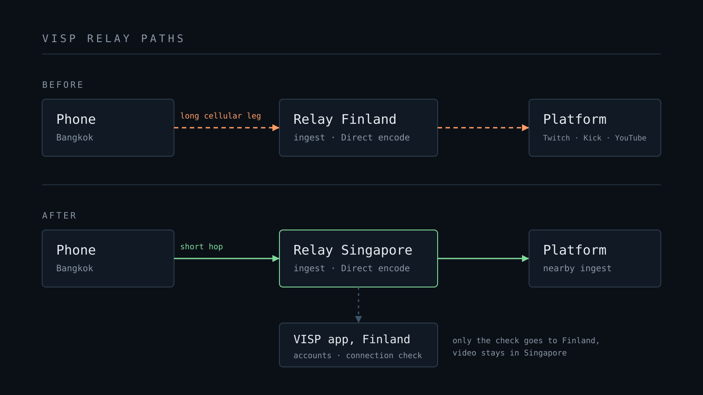

VISP now runs a second relay, in Singapore. Until now every VISP stream
went through one relay in Finland. A phone in Bangkok, Manila, or Sydney sent
its video across two continents before VISP could do anything with it.

The Singapore relay does the whole job locally. It accepts SRT, bonded SRTLA,
RTMP, and browser ingest. It runs the [VISP Direct](/blog/what-is-visp-direct)
encode, serves OBS reads and dashboard previews, and runs Cloud Studio. Video
from a device assigned to Singapore stays in Singapore until it leaves for the
platform or for your OBS.

This post covers who should use it, what changes on the stream, what stays the
same, and how to move a device you already have.

## Who it is for

If you stream from Southeast Asia or Australia, Singapore is much closer to you
than Finland. Japan, Korea, and Taiwan are also closer to Singapore than to
Finland, though by less. You do not have to guess. The app measures every relay
from your phone's network and picks the fastest one.

If you stream from Europe, nothing changes. Finland stays the default relay,
and the VISP app, dashboard, and accounts still run there.

## What changes on the stream

### SRT has more time to repair the picture

SRT fixes lost packets by asking the phone to send them again. Every resend
costs at least one round trip between phone and relay, and the SRT latency
setting is the time budget for all of those resends. On a path from Asia to
Finland a single round trip takes a big share of that budget. A packet that
cannot be resent in time turns into a smeared or frozen frame.

With the relay a short hop away, the same latency setting covers several more
resend attempts. On a choppy cellular connection that means fewer broken
frames. The [bad mobile network guide](/blog/keep-stream-live-bad-mobile-network)
explains the rest of the recovery chain, and none of that changes.

Bonded SRTLA connections end at the Singapore relay too. Wi-Fi and cellular
both connect to Singapore and the relay puts the packets back together there.

### Direct leaves from Singapore

With Direct, the relay re-encodes your feed and sends it to Twitch, Kick,
YouTube, or a custom RTMP, RTMPS, or SRT endpoint. For a device on the
Singapore relay, that encode runs in Singapore and the connection to the
platform starts there. Twitch's ingest address picks an ingest point by
location, so the relay now reaches a nearby Twitch ingest instead of a European
one. Your viewer-facing stream no longer crosses two continents before it even
reaches the platform.

The phone still never holds your stream key. That part is unchanged.

### OBS at home, phone on the road

Say you live in Europe, run OBS at home, and spend two weeks in Thailand. Before
this relay, the long leg ran from your phone to Finland over hotel Wi-Fi or a
local SIM. With the phone on Singapore, the phone's leg is short. The long leg
now runs from Singapore to your home OBS over your home connection.

That is the better place for the distance. A wired home line has less
packet loss and steadier timing than a phone on cellular. Give the SRT media
source in OBS enough latency for the Asia to Europe round trip, and move the
device back to Finland when you are home.

## What stays the same

- Accounts, the dashboard, the chat bot, and platform authorization run in
  Finland. Dashboard and app requests from Asia take a little longer than
  before.
- The Singapore relay checks every new publish or read connection with the
  VISP app in Finland before it accepts it. That adds about a quarter second to
  connecting. Once a stream is connected, its video never goes back to Finland.
  You notice the delay mainly when a phone reconnects many times in a row, for
  example when one bonded link keeps dropping and coming back.
- Device IDs, output settings, and device history stay with a device when it
  moves.
- VISP never moves an existing device on its own. Your devices stay on Finland
  until you move them.

## New devices pick the closest relay

When you add a device in the phone app, the browser publisher, or the
dashboard, VISP measures the round trip to every relay and creates the device
on the fastest one. When the phone app links a new account, it also moves the
account's first, still unused stream path to the relay it measured. If the
measurement fails, the device goes to Finland.

One exception keeps Direct handover working. While a Direct session, BRB
screen, or reservation is active, new devices join that session's relay so
your devices can hand the output to each other.

## Move an existing device to Singapore

1. Stop everything that uses the device: the phone or encoder, OBS sources,
   dashboard previews, and Direct or BRB outputs. Wait a minute after the last
   connection closes. A move is refused while the device is live.
2. On the phone you stream with, open **Settings > Advanced > Relay region**
   and tap **Find best relay**. The app measures from the phone's own network
   and asks before it moves anything. You can also expand the device in the
   dashboard and choose **Move to Singapore**.
3. The device's sending and receiving URLs change and the old ones stop
   working. **Find best relay** updates the VISP app's own URL. After a
   dashboard move, refresh the destination in the app. Update the URL in OBS
   and in any external encoder such as Larix or Moblin.
4. If you hand Direct off between several devices, move all of them to the
   same relay before you go live.

Then [run a private test stream](/blog/test-irl-stream-before-going-live)
before a real show. To go back, stop the device and choose **Move to Finland**
in the dashboard.

## Leave your SRT latency alone at first

A shorter path invites you to lower the SRT latency right away. Wait. Run a few
streams on the new relay with the setting you already trust and watch for
reconnects and broken frames. Lower it only after a stream on a bad network
holds up. Latency you remove is margin you no longer have when the cell tower
gets busy.

## Try it

The [architecture docs](https://docs.visp-stream.com/docs/architecture) explain
how VISP assigns devices to relays. If you stream from Asia, tell us how the
new relay behaves on your network in the
[VISP Discord](https://discord.gg/bufTZqbn4z). Reports from real routes decide
where the next relay goes.

New to VISP? [Get the apps](/download), add one test device, and let the app
pick the relay for you.
